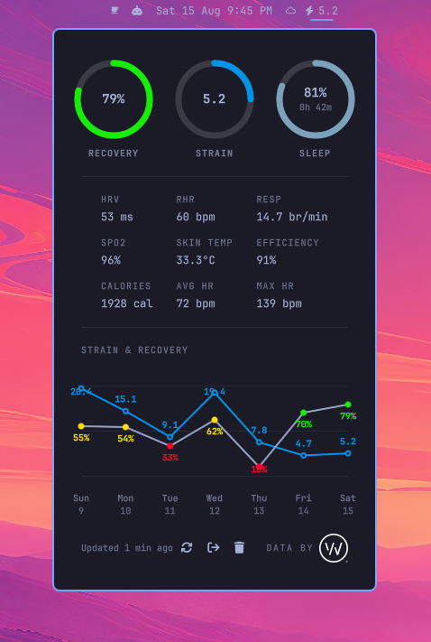

# Omawhoop



Bar widget + popup panel for [WHOOP](https://www.whoop.com/) on [Omarchy](https://omarchy.org/). Shows strain in the bar; click for recovery, sleep, HRV, RHR, SpO2, skin temperature, calories, and a 7-day strain/recovery trend chart.

Not affiliated with or endorsed by WHOOP, Inc. All data stays on your machine — direct HTTPS calls to `api.prod.whoop.com`, no third-party server.

## Requirements

- **Omarchy** (Quickshell-based desktop environment)
- A WHOOP account with a device
- A free WHOOP developer app, created at [developer.whoop.com](https://developer.whoop.com/) (client ID + secret — see Setup below)

## Install

```bash
omarchy plugin add https://github.com/NathanRGagnon/omawhoop.git --enable
```

Or without `--enable`, then turn it on later:

```bash
omarchy plugin enable io.github.nathanrgagnon.omawhoop
```

## Setup

1. Create a free app at [developer.whoop.com](https://developer.whoop.com/). Note its **Client ID** and **Client Secret**.
2. Click the Omawhoop icon in your status bar. The panel shows a **redirect URI** — register that exact URI (`http://localhost:8942/callback`) in your WHOOP app's settings.
3. Enter your Client ID and Client Secret and click **Connect WHOOP**. Approve the browser prompt, and the panel switches to your live data.

## Usage

- **Left click** — open/close the panel
- **Middle click** — force a fresh pull, bypassing the cache
- Data auto-refreshes every 15 minutes in the background

## Update

```bash
omarchy plugin update io.github.nathanrgagnon.omawhoop
```

## Uninstall

```bash
omarchy plugin remove io.github.nathanrgagnon.omawhoop
```

That removes the plugin's code but leaves your saved WHOOP credentials in place in case you reinstall. To also clear those, use the panel's **Remove all data** button, or:

```bash
rm -rf ~/.config/omarchy/omawhoop ~/.local/state/omarchy/omawhoop ~/.cache/omarchy/omawhoop
```

## License

MIT — see [LICENSE](LICENSE).
